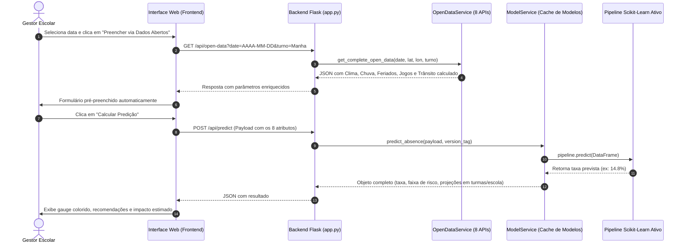
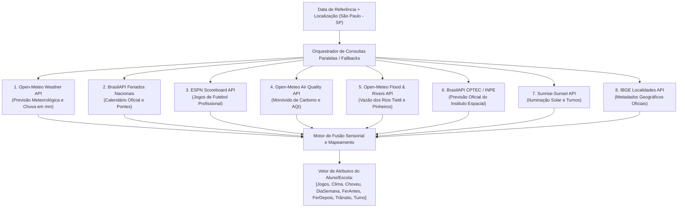

# 🌐 Pipeline de Inferência em Produção e Enriquecimento Automático com APIs de Dados Abertos

> **Documento Técnico de Arquitetura, Integrações e Utilização Prática**  
> **Projeto:** EduPredict AI — Sistema Inteligente de Suporte à Decisão no Combate ao Absenteísmo Escolar  
> **Público-alvo:** Desenvolvedores, Cientistas de Dados, Gestores Educacionais e Comunidade de Software Livre  

---

## 1. Visão Geral do Ciclo de Inferência

O EduPredict AI foi arquitetado para transformar a tomada de decisão pedagógica e administrativa de um modelo reativo (descobrir as faltas após o fechamento do diário de classe) para um modelo **proativo e preditivo** (antecipar a taxa de ausência antes do início das aulas).

A inferência ocorre por dois caminhos:
1. **Inferência Interativa (Simulador Web)**: O gestor acessa a interface web, clica em *"Preencher via Dados Abertos"* e obtém a predição para o turno escolar desejado em milissegundos.
2. **Inferência Programática via API REST**: Sistemas acadêmicos legados (SIGE, Google Classroom, diários eletrônicos) enviam requisições JSON para o endpoint `/api/predict` e recebem as estimativas e faixas de risco.



---

## 2. As 8 APIs de Dados Abertos Integradas

O módulo [`app/open_data_service.py`](../app/open_data_service.py) orquestra consultas a 8 provedores de dados públicos e abertos, **sem necessidade de chaves privadas ou custos de subscrição**, promovendo transparência e sustentabilidade tecnológica.



### 2.1. Detalhamento Técnico das APIs

| # | Serviço | Endpoint Base | Dados Coletados | Mapeamento no Modelo |
|---|---|---|---|---|
| **1** | **Open-Meteo Weather** | `https://api.open-meteo.com/v1/forecast` | `weathercode` (WMO), `precipitation_sum` (mm), `temperature_2m` | Define `Clima` (*Ensolarado, Parcialmente nublado, Nublado, Chuvoso*) e `Choveu?` ($1$ se $>0.5\text{ mm}$ ou código de chuva). |
| **2** | **BrasilAPI Feriados** | `https://brasilapi.com.br/api/feriados/v1/{ano}` | Datas oficiais de feriados nacionais da República | Calcula `Feriado (antes)` e `Feriado (depois)` calculando $\text{data} \pm 1$ dia e emendas de segundas/sextas. |
| **3** | **ESPN Scoreboard** | `https://site.api.espn.com/apis/site/v2/sports/soccer/bra.1/scoreboard` | Partidas do Brasileirão, Copa do Brasil e Libertadores | Popula `Jogos Futebol` com $1$ se houver jogos na data ou fallback de quartas/finais de semana. |
| **4** | **Open-Meteo Air Quality** | `https://air-quality-api.open-meteo.com/v1/air-quality` | `carbon_monoxide` ($\mu\text{g/m}^3$) e índice europeu `european_aqi` | Indicador proxy de intensidade veicular para ajuste fino da variável `Trânsito`. |
| **5** | **Open-Meteo Flood & Rivers** | `https://flood-api.open-meteo.com/v1/flood` | `river_discharge` ($\text{m}^3/\text{s}$) nas bacias metropolitanas | Identifica risco iminente de alagamentos que paralisam linhas de ônibus escolares. |
| **6** | **BrasilAPI CPTEC/INPE** | `https://brasilapi.com.br/api/cptec/v1/clima/previsao/244` | Descrição meteorológica nacional oficial | Utilizado como redundância e verificação cruzada com a Open-Meteo. |
| **7** | **Sunrise-Sunset API** | `https://api.sunrise-sunset.org/json` | Horários UTC de nascer e pôr do sol | Confirmação de luz natural por turno (`Manhã`, `Tarde`, `Noite`). |
| **8** | **IBGE Localidades** | `https://servicodados.ibge.gov.br/api/v1/localidades/municipios/3550308` | Identificação oficial de São Paulo (código 3550308) | Garante consistência geográfica territorial. |

---

## 3. Algoritmo de Fusão Sensorial para o Trânsito Urbano

O nível de trânsito em cidades como São Paulo é altamente correlacionado com múltiplos fatores atmosféricos e temporais. Como as APIs de tráfego em tempo real (ex: Google Maps, Waze) exigem chaves pagas por requisição, o EduPredict AI implementa um **modelo heurístico de fusão sensorial de dados abertos** que infere a intensidade de trânsito em escala discreta de 1 a 5:

```python
def calculate_traffic_level(
    date_obj: datetime.date,
    turno: str,
    choveu: int,
    feriado_antes: int,
    co_level: float,
    river_discharge: float
) -> int:
    weekday = date_obj.weekday()  # 0 = Segunda, ..., 6 = Domingo
    
    # 1. Base temporal por dia e turno
    if weekday in [5, 6]:
        base = 2  # Finais de semana
    elif turno in ["Manhã", "Noite"]:
        base = 4 if weekday in [2, 4] else 3  # Picos em quartas e sextas
    else:
        base = 3  # Turno vespertino
        
    # 2. Agravantes ambientais e de mobilidade
    if choveu == 1:
        base += 1  # Chuva reduz velocidade média em até 35%
    if feriado_antes == 1:
        base += 1  # Véspera de feriado provoca êxodo urbano e saturação de vias
    if co_level > 400.0:
        base += 1  # Elevada emissão de CO indica lentidão e congestionamento severo
    if river_discharge > 25.0:
        base += 1  # Vazão crítica em rios urbanos (iminência de transbordamento)

    # 3. Delimitação na escala válida [1, 5]
    return max(1, min(5, base))
```

---

## 4. Estrutura do Arquivo CSV para Treinamento e Inferência em Lote

Para retreinar o modelo ou alimentar predições em massa, os dados devem estar organizados no formato tabular padronizado. O template oficial pode ser baixado diretamente pelo botão da aplicação ou gerado a partir do schema abaixo.

### 4.1. Schema das Colunas do CSV

```csv
Data,Presença,Jogos Futebol,Clima,Choveu?,Dia da Semana,Feriado (antes),Feriado (depois),Trânsito,TURNO,TYPE,%
```

| Coluna | Tipo | Exemplo | Descrição / Regra |
|---|---|---|---|
| **Data** | Data ISO (`AAAA-MM-DD`) | `2024-03-04` | Data do dia letivo considerado. |
| **Presença** | Inteiro | `1` | Marcador de registro letivo ativo. |
| **Jogos Futebol** | Inteiro ($\{0, 1\}$) | `0` | $1$ se houve jogos expressivos no dia; $0$ caso contrário. |
| **Clima** | String | `Ensolarado` | Um dos 4 valores válidos: `Ensolarado`, `Parcialmente nublado`, `Nublado` ou `Chuvoso`. |
| **Choveu?** | Inteiro ($\{0, 1\}$) | `0` | $1$ se houve registro de precipitação; $0$ para tempo seco. |
| **Dia da Semana** | String | `Segunda` | `Segunda`, `Terça`, `Quarta`, `Quinta`, `Sexta`, `Sábado` ou `Domingo`. |
| **Feriado (antes)** | Inteiro ($\{0, 1\}$) | `0` | $1$ se o dia seguinte for feriado nacional ou emenda. |
| **Feriado (depois)** | Inteiro ($\{0, 1\}$) | `0` | $1$ se o dia anterior foi feriado nacional ou retorno de emenda. |
| **Trânsito** | Inteiro ($1$ a $5$) | `3` | Nível de congestionamento ($1=\text{Fluido}$, $3=\text{Médio}$, $5=\text{Crítico}$). |
| **TURNO** | String | `Manhã` | `Manhã`, `Tarde` ou `Noite`. |
| **TYPE** | String | `FALTA` | Identificador de modalidade da métrica. |
| **%** | Ponto Flutuante | `9.5` | **Variável Alvo (Target)**: Taxa real observada de faltas (em %). |

---

## 5. Como Enriquecer um CSV Histórico com as APIs Abertas (Script Python)

Se a sua escola possui apenas o histórico com **Data**, **Turno** e a **Taxa de Faltas (%)**, você pode utilizar o script abaixo para consultar as APIs abertas retroativamente e gerar o CSV completo pronto para treinamento:

```python
"""
Script utilitário para enriquecer registros históricos escolares com APIs Abertas.
Execute: python enriquecer_historico.py
"""

import requests
import datetime
import pandas as pd

def preencher_linha_com_apis(data_iso: str, turno: str, taxa_faltas: float):
    # Consulta a API interna de dados abertos do EduPredict
    url = f"http://localhost:5001/api/open-data?date={data_iso}&turno={turno}"
    resp = requests.get(url)
    
    if resp.status_code == 200:
        info = resp.json()["data"]
        return {
            "Data": data_iso,
            "Presença": 1,
            "Jogos Futebol": info["jogos_futebol"],
            "Clima": info["clima"],
            "Choveu?": info["choveu"],
            "Dia da Semana": info["dia_da_semana"],
            "Feriado (antes)": info["feriado_antes"],
            "Feriado (depois)": info["feriado_depois"],
            "Trânsito": info["transito"],
            "TURNO": turno,
            "TYPE": "FALTA",
            "%": round(float(taxa_faltas), 2)
        }
    else:
        raise RuntimeError(f"Falha ao consultar APIs para {data_iso}: {resp.text}")

# Exemplo prático de enriquecimento em lote:
dados_brutos = [
    {"data": "2024-05-02", "turno": "Manhã", "falta_pct": 14.2},
    {"data": "2024-05-03", "turno": "Tarde", "falta_pct": 18.0},
    {"data": "2024-05-06", "turno": "Noite", "falta_pct": 21.5},
]

linhas_enriquecidas = [
    preencher_linha_com_apis(item["data"], item["turno"], item["falta_pct"])
    for item in dados_brutos
]

df_pronto = pd.DataFrame(linhas_enriquecidas)
df_pronto.to_csv("meu_dataset_escola_enriquecido.csv", index=False, encoding="utf-8")
print("✅ Dataset enriquecido e pronto para treinamento gerado com sucesso!")
```

---

## 6. Interpretação dos Resultados e Tomada de Decisão Educacional

Ao receber a predição da porcentagem de ausências, o sistema classifica o resultado em três faixas operacionais bem delineadas:

| Faixa de Risco | Taxa Prevista (%) | Sinalização Visual | Ação Gestora Recomendada |
|---|---|---|---|
| 🟢 **Baixo** | $< 10.0\%$ | Badge Verde Esmeralda | **Operação Regular Padrão:** Presença esperada em nível saudável. Manter preparo habitual da merenda e cronograma pedagógico padrão de aulas e provas. |
| 🟡 **Moderado** | $10.0\% \text{ a } 18.0\%$ | Badge Âmbar / Amarelo | **Atenção Preventiva:** Sensibilidade moderada ao clima ou proximidade de feriados. Recomenda-se alertar transportadores escolares e planejar atividades de reforço. |
| 🔴 **Crítico / Alto** | $> 18.0\%$ | Badge Vermelho Alerta | **Plano de Contingência:** Risco grave de evasão pontual severa. Redimensionar preparo de alimentos perecíveis na merenda para evitar desperdício orçamentário; emitir comunicado preventivo aos pais via aplicativo/SMS; evitar aplicação de provas bimestrais decisivas no turno. |

### 6.1. Projeção Prática de Impacto Discente
Para além do percentual frio, a interface converte instantaneamente o resultado em números humanos absolutos:
- **Turma Típica (40 alunos):** $\text{Ausências} = \text{round}\left(\frac{\%}{100} \times 40\right)$
- **Escola de Médio Porte (500 alunos):** $\text{Ausências} = \text{round}\left(\frac{\%}{100} \times 500\right)$
- **Desvio em Relação à Média Histórica:** $\Delta = \%_{\text{previsto}} - \bar{\%}_{\text{histórico}}$, indicando visualmente se o dia se comportará acima ou abaixo da média histórica da instituição.
