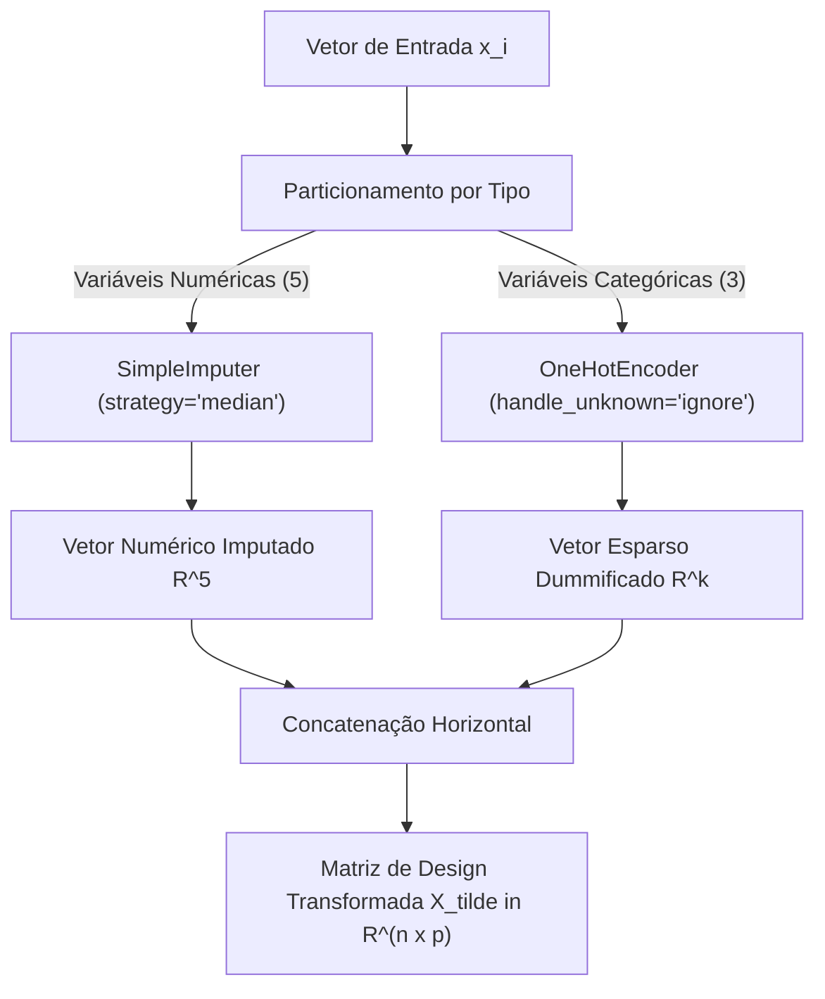
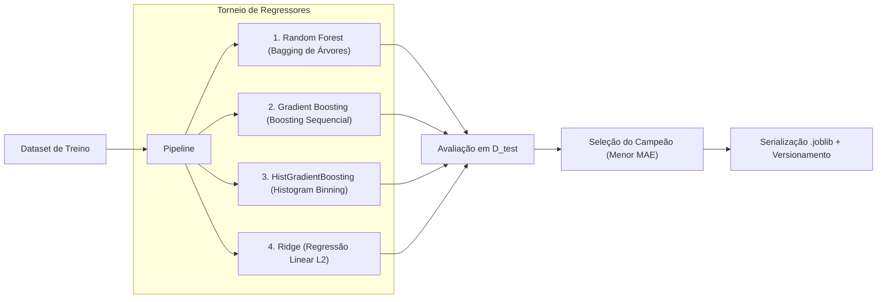

# Fundamentação Teórica, Engenharia de Features e Treinamento de Modelos Preditivos de Absenteísmo Escolar

> **Documento Técnico-Científico para Avaliação Acadêmica em Ciência da Computação**  
> **Projeto:** EduPredict AI — Sistema Inteligente de Suporte à Decisão no Combate ao Absenteísmo Escolar  
> **Área:** Aprendizado de Máquina Supervisionado, Engenharia de Software e MLOps  

---

## 1. Introdução e Formulação Matemática do Problema

O absenteísmo discente é um fenômeno multifatorial influenciado por condicionantes meteorológicos, de mobilidade urbana, do calendário civil e de eventos sociais de grande repercussão. No contexto de Ciência da Computação e Aprendizado de Máquina (*Machine Learning*), o problema é formalizado como uma **tarefa de regressão supervisionada não linear multivariada**.

### 1.1. Definição Formal

Seja $\mathcal{D} = \{(\mathbf{x}_i, y_i)\}_{i=1}^{N}$ o conjunto de treinamento composto por $N$ observações históricas, onde:
- Cada vetor de atributos $\mathbf{x}_i \in \mathcal{X}$ reside em um espaço de características heterogêneo de dimensão $d$, contendo variáveis contínuas, discretas e categóricas nominais.
- O rótulo contínuo $y_i \in \mathcal{Y} \subset \mathbb{R}_{\ge 0}$ representa a **taxa percentual de faltas discentes** verificada na escola para o turno e data correspondentes, com $y_i \in [0, 100]$.

O objetivo do treinamento consiste em encontrar uma função hipótese $f^*: \mathcal{X} \to \mathcal{Y}$ pertencente a uma família de funções $\mathcal{H}$ que minimize o risco empírico sob uma função de perda $\mathcal{L}$:

$$f^* = \arg\min_{f \in \mathcal{H}} \frac{1}{N} \sum_{i=1}^{N} \mathcal{L}(y_i, f(\mathbf{x}_i)) + \Omega(f)$$

Onde $\Omega(f)$ denota o termo de regularização para penalizar a complexidade estrutural do modelo e prevenir o sobreajuste (*overfitting*).

---

## 2. Espaço de Características e Engenharia de Features

O sistema seleciona um vetor de atributos $\mathbf{x} = [x_1, x_2, \dots, x_8]^T$ particionado em dois subespaços complementares:

$$\mathcal{X} = \mathcal{X}_{\text{num}} \times \mathcal{X}_{\text{cat}}$$

### 2.1. Dicionário de Variáveis de Entrada

| Atributo | Tipo Estatístico | Domínio / Valores | Papel Teórico no Absenteísmo |
|---|---|---|---|
| **Jogos Futebol** | Binário ($\{0, 1\}$) | $0$ (Não), $1$ (Sim) | Eventos desportivos noturnos impactam o sono e a presença discente. |
| **Clima** | Categórico Nominal | `{Ensolarado, Parcialmente nublado, Nublado, Chuvoso}` | Condições climáticas desfavoráveis desestimulam o deslocamento a pé e por transporte ativo. |
| **Choveu?** | Binário ($\{0, 1\}$) | $0$ (Não), $1$ (Sim) | Chuva efetiva gera pontos de alagamento e atrasos severos no transporte público. |
| **Dia da Semana** | Categórico Nominal | `{Segunda, Terça, Quarta, Quinta, Sexta, Sábado, Domingo}` | Efeito sazonal intra-semanal (ex: pico histórico de evasão em sextas-feiras e segundas). |
| **Feriado (antes)** | Binário ($\{0, 1\}$) | $0$ (Não), $1$ (Sim) | Vésperas de feriados nacionais e pontes de emenda escolar. |
| **Feriado (depois)** | Binário ($\{0, 1\}$) | $0$ (Não), $1$ (Sim) | Retorno de feriados prolongados com desmotivação ou viagens familiares. |
| **Trânsito** | Ordinal Discreto | $\{1, 2, 3, 4, 5\}$ | Nível de congestionamento e lentidão viária na malha urbana (1=Fluido, 5=Crítico). |
| **TURNO** | Categórico Nominal | `{Manhã, Tarde, Noite}` | Heterogeneidade no perfil do alunado (trabalhadores à noite, crianças de manhã). |

### 2.2. Pipeline de Pré-processamento Matricial

Para garantir a ausência de vazamento de dados (*data leakage*) e assegurar que as transformações aprendidas no treino sejam aplicadas deterministicamente em inferência, utiliza-se a abstração `ColumnTransformer` do Scikit-Learn:



#### Formulação da Dummificação (One-Hot Encoding):
Para uma variável categórica $c \in \mathcal{C}$ com $|\mathcal{C}| = K$ categorias, a transformação gera $K$ variáveis binárias indicadoras:

$$\phi_k(c) = \begin{cases} 1, & \text{se } c = k \\ 0, & \text{caso contrário} \end{cases}$$

Com a garantia de parametrização `handle_unknown="ignore"`, qualquer categoria anômala encontrada em tempo de inferência é mapeada para um vetor nulo $\mathbf{0}$, impedindo exceções em tempo de execução.

---

## 3. Particionamento de Dados e Isolamento Experimental

O conjunto de dados é dividido em partições disjuntas de Treinamento e Teste via `train_test_split`:

$$\mathcal{D} = \mathcal{D}_{\text{train}} \cup \mathcal{D}_{\text{test}}, \quad \mathcal{D}_{\text{train}} \cap \mathcal{D}_{\text{test}} = \emptyset$$

- **Razão Parametrizável de Teste ($s_{\text{test}} \in (0, 1)$):** O sistema permite selecionar dinamicamente a divisão (ex: 80%/20%, 75%/25%, 70%/30%).
- **Reprodutibilidade:** Fixação da semente do gerador pseudo-aleatório (`random_state=42`), garantindo que qualquer experimento possa ser auditado e reproduzido pela comunidade científica.
- **Princípio da Caixa-Preta do Conjunto de Teste:** O pré-processador executa `fit` estritamente em $\mathcal{D}_{\text{train}}$, aplicando apenas `transform` em $\mathcal{D}_{\text{test}}$.

---

## 4. Torneio de Algoritmos Candidatos (Model Benchmarking)

Em vez de assumir a priori uma única hipótese algorítmica, o pipeline executa um **torneio de modelos de aprendizado de máquina concorrentes**, contemplando diferentes paradigmas:



### 4.1. Random Forest Regressor (Ensemble por Bagging)
Uma floresta aleatória constrói um comitê de $B=300$ estimadores de árvores de regressão CART (*Classification and Regression Trees*), cada uma treinada sobre uma amostra bootstrap $\mathcal{D}^{(b)}$ extraída com reposição de $\mathcal{D}_{\text{train}}$:

$$\hat{y}_{\text{RF}}(\mathbf{x}) = \frac{1}{B} \sum_{b=1}^{B} T_b(\mathbf{x})$$

- **Redução de Variância:** Se cada árvore possui variância $\sigma^2$ e a correlação entre árvores distintas é $\rho$, a variância do comitê decresce assintoticamente:
  
  $$\text{Var}(\hat{y}_{\text{RF}}) = \rho \sigma^2 + \frac{1-\rho}{B} \sigma^2$$
  
- A aleatorização do subconjunto de features testadas em cada nó ($m \approx \sqrt{p}$) descorrelaciona as árvores, reduzindo $\rho$.

### 4.2. Gradient Boosting Regressor (Ensemble por Boosting)
Diferente do Bagging que atua em paralelo, o *Gradient Boosting* opera de forma sequencial iterativa. Cada nova árvore $h_m(\mathbf{x})$ é ajustada aos pseudorresíduos (gradiente negativo da função de perda L2) acumulados pelos estágios anteriores:

$$r_{im} = -\left[\frac{\partial \mathcal{L}(y_i, f(\mathbf{x}_i))}{\partial f(\mathbf{x}_i)}\right]_{f = f_{m-1}} = y_i - f_{m-1}(\mathbf{x}_i)$$

O modelo final é a soma ponderada com taxa de aprendizagem (*shrinkage*) $\eta$:

$$f_M(\mathbf{x}) = f_0(\mathbf{x}) + \sum_{m=1}^{M} \eta \gamma_m h_m(\mathbf{x})$$

### 4.3. HistGradientBoosting Regressor
Implementação inspirada no LightGBM voltada para máxima eficiência algorítmica. Mapeia variáveis numéricas contínuas para 256 intervalos discretos (*integer bins*). Substitui a busca exaustiva de pontos de corte ($O(N \cdot p)$) pelo cômputo sobre histogramas ($O(\text{bins} \cdot p)$), alcançando ganho de ordens de magnitude em velocidade de convergência com mínimo impacto no erro.

### 4.4. Ridge Regressor (Regularização de Tikhonov)
Modelo paramétrico linear que minimiza a soma dos quadrados dos resíduos penalizada pela norma Euclidiana ao quadrado dos coeficientes:

$$\hat{\boldsymbol{\beta}}_{\text{Ridge}} = \arg\min_{\boldsymbol{\beta}} \left\{ \|\mathbf{y} - \mathbf{X}\boldsymbol{\beta}\|_2^2 + \alpha \|\boldsymbol{\beta}\|_2^2 \right\}$$

Possui solução analítica exata em forma fechada:

$$\hat{\boldsymbol{\beta}}_{\text{Ridge}} = (\mathbf{X}^T \mathbf{X} + \alpha \mathbf{I})^{-1} \mathbf{X}^T \mathbf{y}$$

O parâmetro $\alpha = 1.0$ controla a contração dos coeficientes em direção a zero, mitigando problemas de multicolinearidade decorrentes da dummificação.

---

## 5. Métricas de Avaliação e Critério de Desempate

A validação em $\mathcal{D}_{\text{test}}$ é conduzida sob três métricas complementares:

### 5.1. Erro Médio Absoluto (MAE — Critério Decisório Primário)
$$\text{MAE} = \frac{1}{n_{\text{test}}} \sum_{i=1}^{n_{\text{test}}} |y_i - \hat{y}_i|$$
- **Justificativa da Escolha como Métrica Campeã:** O MAE mede o desvio médio na mesma unidade física da variável explicada (pontos percentuais de alunos ausentes). Diferente do MSE, não super-penaliza outliers atípicos (ex: uma tempestade catastrófica pontual), refletindo com clareza o erro operacional diário esperado pelo gestor escolar.

### 5.2. Raiz do Erro Quadrático Médio (RMSE)
$$\text{RMSE} = \sqrt{\frac{1}{n_{\text{test}}} \sum_{i=1}^{n_{\text{test}}} (y_i - \hat{y}_i)^2}$$
- Útil para sinalizar a ocorrência de grandes erros pontuais na predição, penalizando desvios elevados quadraticamente.

### 5.3. Coeficiente de Determinação ($R^2$)
$$R^2 = 1 - \frac{\sum_{i=1}^{n_{\text{test}}} (y_i - \hat{y}_i)^2}{\sum_{i=1}^{n_{\text{test}}} (y_i - \bar{y})^2}$$
- Quantifica a fração da variabilidade total observada nas faltas escolares que é explicada estatisticamente pelos regressores do modelo.

---

## 6. Teoria da Importância de Atributos (Feature Importance)

Um dos maiores desafios em modelos de Aprendizado de Máquina é o dilema entre **desempenho preditivo** e **interpretabilidade** (*Explainable AI — XAI*). O EduPredict AI extrai e decompõe os pesos matemáticos atribuídos a cada fator.

### 6.1. Redução Média de Impureza (MDI - Mean Decrease Impurity)
Para modelos baseados em árvores (Random Forest e Gradient Boosting), a importância de uma feature $f$ é calculada somando a redução ponderada de variância em todos os nós internos $t$ onde $f$ foi a variável ótima de cisão:

$$\text{MDI}(f) = \sum_{T \in \text{Florestas}} \sum_{t \in T: v(s_t) = f} \frac{N_t}{N_{\text{total}}} \Delta \text{Var}(t)$$

Onde $\Delta \text{Var}(t)$ é o ganho de pureza quadrática obtido ao dividir a partição $t$ em filhos $t_E$ e $t_D$:

$$\Delta \text{Var}(t) = \text{Var}(t) - \left( \frac{N_{t_E}}{N_t}\text{Var}(t_E) + \frac{N_{t_D}}{N_t}\text{Var}(t_D) \right)$$

### 6.2. Pesos Normalizados para Modelos Lineares (Ridge)
Quando o algoritmo Ridge vence o torneio, a importância relativa de cada feature transformada $j$ é derivada a partir da magnitude absoluta de seu coeficiente padronizado:

$$w_j = \frac{|\beta_j|}{\sum_{k=1}^{p} |\beta_k|}, \quad \sum_{j=1}^{p} w_j = 1$$

### 6.3. Agrupamento e Consolidação Semântica
Como o One-Hot Encoding fragmenta atributos categóricos em múltiplas colunas (ex: `Clima_Chuvoso`, `Clima_Ensolarado`, `Clima_Nublado`), o algoritmo `extract_feature_importances` recompõe a contribuição agregada de cada variável macro:

$$W_{\text{original}} = \sum_{j \in \text{colunas dummificadas de original}} w_j$$

Isso possibilita exibir no dashboard gráficos de barras e rosqueados (*donut charts*) intuitivos para os tomadores de decisão educacional, informando, por exemplo: *"O Clima é responsável por 31.4% da variância das faltas, enquanto o Trânsito responde por 24.8%"*.

---

## 7. Versionamento, Catálogo e Governança de Artefatos

O ciclo de vida de treinamento é finalizado com a persistência de artefatos segundo boas práticas de MLOps:

1. **Serialização do Pipeline Completo:** O objeto `sklearn.pipeline.Pipeline` (contendo o pré-processador treinado e o regressor vencedor) é salvo em formato binário comprimido `joblib`:
   ```python
   joblib.dump(best_pipeline, "models/modelo_v2.0-exemplo.joblib")
   ```
2. **Registro de Auditoria em Catálogo (`models/registry.json`):**
   Cada versão treinada armazena uma ficha técnica completa:
   - Identificador único da versão (`version`).
   - Timestamp ISO-8601 da criação.
   - Algoritmo vencedor e métricas nos testes (`MAE`, `RMSE`, `R2`).
   - Tabela comparativa do desempenho dos outros 3 algoritmos descartados no torneio.
   - Distribuição percentual do split (ex: 80% treino com 1200 amostras / 20% teste com 300 amostras).
   - Estatísticas do target ($\mu, \min, \max$).
   - Vetores normalizados de importância das features (`grouped` e `detailed`).
3. **Chaveamento Atômico em Tempo de Execução:** O gestor pode alternar o modelo ativo instantaneamente via interface ou API (`POST /api/models/activate`), sem necessidade de reinicializar servidores ou suspender a disponibilidade do serviço.
